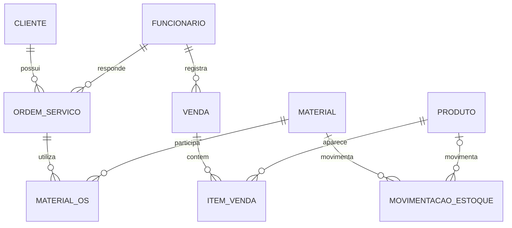

# Modelo de dados — visão inicial do sistema

[Índice](README.md) · [Guia do Projeto](guia-do-projeto.md) · [Contrato da API](api.md) · [Telas e fluxos](telas-e-fluxos.md)

## Escopo e situação

Modelo do banco sujeito a evolução. O contrato da API e o documento de telas descrevem os fluxos atuais; as tabelas de negócio cobrem cadastros, compras, estoque, OS e vendas.

- **Definição da equipe:** objetivos dos módulos (Guia §§1.3, 4 e 5; RF-003 a RF-011), PostgreSQL (§7.1), cadastro de funcionários exclusivo do administrador (RN-001) e venda independente de OS (RN-008).
- **Exigência acadêmica:** validação, chaves estrangeiras, consistência, estoque não negativo e segurança (§8.2; RNF-004/RNF-005, RN-018/RN-019).
- **Sugestões das fontes:** entidades e campos do §10, detalhes do §5 e fluxos do §6. Sua presença neste modelo não os aprova.
- **Implementação aprovada:** tabelas de negócio em `sapataria`, com campos, tipos, chaves e obrigatoriedade descritos abaixo. Fluxos de gravação e total da venda implementados; cálculo automático da OS e indicadores financeiros pendentes.
- **Pendências de negócio:** apontadas junto aos elementos afetados, por identificadores de [regras de negócio](regras-de-negocio.md#pendencias). Ausência de definição não significa campo opcional.

**Situação atual:** `backend/src/database/schema.sql` reúne o esquema completo em ordem de dependência para instalar um banco novo. Não o execute no banco configurado: estruturas de Clientes, Funcionários, entidades, operações, fornecedores e estoque já foram aplicadas em etapas anteriores; as evoluções de perfil e a configuração comercial ainda estão pendentes nesse banco. Produtos legados permanecem sem mínimo até configuração. Há tabelas técnicas de autenticação.

## Convenções adotadas

**PK** é a chave primária: identifica uma linha. **FK** é a chave estrangeira: aponta para uma linha existente de outra tabela. Por exemplo, `cliente_id` aponta para `clientes.id`.

As tabelas principais possuem `id integer` gerado pelo banco, PK, único e não nulo; associações usam chave primária composta. As FKs usam `integer`. Essa exigência técnica de identificação não torna obrigatório um dado cadastral.

A obrigatoriedade abaixo incorpora as decisões confirmadas pelo Integrante 1. Não há unicidade de nomes/contatos nem exclusões em cascata; usuário de login tem unicidade própria. Remoção de Clientes exige ausência de vínculos; Materiais/Produtos exigem também saldo zero. OS/Vendas e movimentos preservam o histórico.

Tipos: `text` para textos; `boolean` para ativo; `numeric` sem escala fixa para valores e quantidades, sem impor arredondamento ainda não aprovado; `date` para datas sem horário; `timestamptz` para instantes. A API retorna numeric como string decimal, date como `YYYY-MM-DD` e timestamptz como ISO 8601 UTC; IDs continuam números inteiros. Essa representação preserva precisão e datas. Restrições de operação permitem frações de materiais e exigem unidades inteiras para produtos; valores monetários têm até duas casas.

## Diagrama geral — relações implementadas

`||` significa exatamente um; `o|`, zero ou um; `o{`, zero ou vários. Cliente e responsável da OS, vendedor da venda e vínculos das tabelas intermediárias são obrigatórios.

Um cliente pode estar associado a várias OS; cada OS aponta para exatamente um cliente. Um funcionário pode responder por várias OS e registrar várias vendas. Confirmar se a loja precisa de mais de um responsável por OS antes de mudar essa estrutura (PD-N03).

Uma OS pode utilizar vários materiais e o mesmo material pode aparecer em várias OS: `MATERIAL_OS` registra cada uso. Da mesma forma, `ITEM_VENDA` liga uma venda aos produtos vendidos. A estrutura exige os dois vínculos em cada linha dessas tabelas intermediárias. O diagrama não decide o mínimo de itens para concluir uma venda, nem se o mesmo produto/material pode aparecer repetido na mesma operação (PD-N03/PD-N07).

Cada movimentação aponta **para um Material ou um Produto, nunca ambos**, conforme restrição aplicada no banco; as duas ligações opcionais no diagrama devem ser lidas juntas com essa condição.

**Relações ainda não desenhadas:** Cliente–Venda (histórico de compras sugerido no §5.3, mas ausente no §10) e OS–Venda (vendas ligadas a OS no §1.3, sem modelo correspondente no §10). A existência de venda independente está definida, mas não resolve como representar as vendas ligadas a OS. Cardinalidade e campos desses vínculos permanecem pendentes; não se cria tabela adicional nem FK por suposição (PD-N03/PD-N05).

## Entidades e campos

### Funcionário/usuário — `sapataria.funcionarios`

**Confirmado e implementado:** conta individual com usuário e senha, sem Supabase Auth. Referências: RF-001/RF-005/RF-015/RF-019, RN-001/RN-004. Tabela e índices aplicados no Supabase; verificação com dados temporários revertida.

| Campo | Tipo | Obrigatoriedade / regra |
|---|---|---|
| `id` | `integer` | Gerado pelo banco, chave primária |
| `nome` | `text` | Obrigatório |
| `usuario` | `text` | Obrigatório; único pelo índice `lower(usuario)`; API remove espaços externos e salva em minúsculas |
| `email` | `text` | Obrigatório como contato; não é login; sem unicidade exigida |
| `cpf` | `text` | 11 dígitos; obrigatório no novo cadastro/edição pessoal; nulo permitido em legado; API valida dígitos verificadores |
| `telefone` | `text` | 11 dígitos; obrigatório no novo cadastro/edição pessoal; nulo permitido em legado |
| `senha_protegida` | `text` | Obrigatório; hash scrypt com salt; nunca devolvido pela API |
| `perfil` | `text` | Obrigatório; administrador ou funcionario; sem padrão |
| `ativo` | `boolean` | Obrigatório no banco; padrão true |
| `versao_acesso` | `integer` | Técnico; padrão 1; incrementa ao mudar perfil/ativo ou trocar senha; invalida sessões anteriores |

A API recebe `senha` (15–128 caracteres no cadastro de contas), não `senha_protegida`. A senha não é normalizada. Nenhum cadastro público: o primeiro administrador é criado pelo comando local `npm run criar:admin`, que recusa execução quando já existem funcionários. Só administradores autenticados gerenciam as demais contas. A troca da própria senha está implementada em rota autenticada com política própria de no mínimo 8 caracteres, sem limite máximo, incluindo maiúscula, minúscula e caractere especial; recuperação continua pendente.

**Tabelas técnicas:** `sessoes` (`sid`, `sess`, `expire`) armazena identificadores e estado de sessão conforme connect-pg-simple; `tentativas_login` (`chave`, `tentativas`, `expira_em`) controla tentativas por usuário/IP com chaves derivadas por HMAC, sem senha. Sessões contêm ID do funcionário, versão de acesso, expiração e token CSRF, não dados da credencial. Limite absoluto de 8h; mudança de acesso exige novo login. Essas tabelas não representam novas entidades de negócio.

**Tabelas de atividade preparadas e aplicadas em 15/10/2026:** `atividades` guarda ator e nome histórico, ação, tipo/ID da entidade, detalhes limitados e instante; `notificacoes` guarda atividade, destinatário, mensagem e instante de leitura. Ator e destinatário referenciam Funcionários, mantendo atividades após desativação; remoção de destinatário apaga suas notificações. A estrutura está incluída em `backend/src/database/schema.sql` para instalações novas. A alteração incremental foi aplicada ao banco Supabase configurado no backend e a existência das duas tabelas foi confirmada; o script separado foi removido na consolidação SQL.

**Evolução aprovada pelo Integrante 1 em 30/09/2026:** CPF e telefone obrigatórios no cadastro e na edição pessoal; sem unicidade nova. A definição consolidada acrescenta colunas nulas aos registros antigos, restrições de formato e gatilho de obrigatoriedade apenas para INSERT/UPDATE dos campos pessoais. Assim, alterar acesso/desativar legados continua possível sem inventar CPF/telefone. Edição de nome, email, cpf e telefone exige senha do Administrador conectado. Funcionário comum pode apenas consultar seu próprio perfil e suas OS. Foto adiada explicitamente.

Essa evolução está incluída em `backend/src/database/schema.sql` para instalações novas. **Ainda não aplicada ao banco existente**; o arquivo completo não é um script de atualização incremental. O bootstrap do primeiro Administrador foi atualizado para solicitar os novos campos.

O arquivo consolidado `backend/src/database/schema.sql` reúne a estrutura para instalações novas. Ele não atualiza bancos existentes: alterações nesses bancos exigem scripts incrementais versionados. Os scripts incrementais anteriores foram removidos na consolidação e precisam ser recriados caso alguma atualização ainda pendente seja necessária.

### Dados comerciais da loja — `sapataria.configuracoes_loja`

Decisão do Integrante 1 em 15/10/2026: manter o endereço da loja para consulta por ambos os perfis e uso na futura Landing Page; somente Administrador pode alterá-lo. A tabela tem um único registro (`id = 1`) e um campo `endereco text`; texto vazio é permitido para não inventar obrigatoriedade, e o limite é 500 caracteres. A interface consulta rua, bairro, cidade e UF pelo ViaCEP a partir do CEP informado, solicita também o número e persiste um único endereço formatado; indisponibilidade do ViaCEP permite salvar CEP e número sem os demais dados. Preferências de notificações e tema são específicas por funcionário, ficam no `localStorage` deste navegador e não criam colunas nem API.

`backend/src/database/schema.sql` cria a tabela e seu registro inicial sem apagar dados em uma instalação nova. **Essa estrutura ainda não foi aplicada ao banco existente.** A seção comercial da tela dependerá da atualização do esquema desse banco. RF-024; RN-003.

## Cliente

**Tabela:** `sapataria.clientes`. Evolução aprovada pelo Integrante 1 em 29/09/2026: CPF, telefone de 11 dígitos, CEP e número no lugar do endereço livre, data de cadastro e perfil com OS. Em 23/10/2026, a equipe definiu CPF opcional; quando informado, segue validado. Código atualizado; a definição consta no `schema.sql` para bancos novos. A atualização ainda não foi aplicada ao banco existente; o script incremental preparado foi removido na consolidação e precisará ser recriado para essa atualização.

| Campo | Tipo PostgreSQL / JSON | Obrigatoriedade |
|---|---|---|
| `id` | `integer` / número | Gerado pelo banco |
| `nome` | `text` / string | Obrigatório |
| `telefone` | `text` / string | Obrigatório, 11 dígitos |
| `cpf` | `text` / string ou null | Opcional; se informado, 11 dígitos e verificação dos dígitos na API |
| `cep` | `text` / string | Obrigatório, 8 dígitos |
| `numero` | `text` / string | Obrigatório; aceita identificação como `123A` ou `S/N` |
| `criado_em` | `timestamptz` / string ISO | Automático para novos registros; somente leitura |
| `endereco` | `text` / string ou null | Preservado apenas como dado legado |
| `email`, `observacoes` | `text` / string ou null | Opcionais |

CPF, telefone e CEP são persistidos sem pontuação. A interface aplica máscaras. Não foi acrescentada unicidade de CPF ou contatos. A validação de CPF verifica o cálculo, sem consultar sua situação cadastral. CPF ausente ou vazio vira `NULL`; e-mail e observações opcionais vazios também viram `NULL`.

A migração preserva CPF/CEP/número/data ausentes dos registros antigos, sem inventar valores nem converter endereço livre automaticamente. Restrições `CHECK ... NOT VALID` não revalidam linhas antigas; as de telefone, CEP e número exigem campos válidos nas novas inserções e atualizações. CPF pode ser nulo, mas deve ter 11 dígitos quando informado. A API também exige os demais campos obrigatórios no PUT. A data antiga permanece desconhecida, mesmo após edição. O script não remove o endereço legado nem altera vínculos de OS.

Somente CEP e número são gravados como novo endereço. Rua, bairro, cidade e UF são consultados no ViaCEP pela interface; campos ausentes na resposta são apresentados como não informados. Falha da consulta não impede salvar os dados informados e não equivale a validação da existência do CEP pela API. RF-003/RF-017/RF-026.

### Pendências de Clientes

- Clientes exige login e permite os dois perfis; operações de alteração exigem token CSRF. Exclusão permitida somente sem OS vinculada.

## Ordem de serviço — `ordens_servico`

RF-004/RF-018. Todos os campos abaixo são obrigatórios, exceto `prazo_entrega`, `forma_pagamento` e `observacoes`.

| Campo (além de id) | Tipo / vínculo | Definição |
|---|---|---|
| cliente_id | integer → clientes.id | Cliente atendido |
| responsavel_id | integer → funcionarios.id | Responsável pelo serviço; não define automaticamente autoria |
| descricao_calcado | text | Descrição do calçado |
| servico | text | Descrição do serviço nesta etapa; não foi criado catálogo auxiliar |
| valor | numeric | Valor informado, sem cálculo automático |
| data_entrada | date | Padrão: data do registro em America/Sao_Paulo |
| prazo_entrega | date, opcional | Sem prazo padrão |
| status | text | Padrão Aberta; Em andamento, Pronta, Entregue ou Cancelada, conforme RN-010 |
| forma_pagamento | text, opcional | pix, credito, debito ou dinheiro |
| observacoes | text, opcional | Anotações |

Usos de materiais ficam em `materiais_os`. Cadastro, edição, avanço de status, consumo, devolução e cancelamento estão disponíveis na API, conforme RN-010/RN-012. O cálculo da OS foi adiado pelo usuário.

## Estoques — `materiais` e `produtos`

**Complemento confirmado por João Franco:** o esquema consolidado inclui `prazo_pagamento`, `meios_pagamento`, `desconto` e `moeda` como text nullable, com CHECK de texto não vazio quando presente. A atualização foi aplicada com os quatro campos, sem preencher dados desconhecidos. São condições comerciais informativas; compras de estoque geram lançamentos financeiros de saída e atualizam o custo atual pelo método médio ponderado. Histórico exibido pela interface usa `movimentacoes_estoque` existente, sem duplicação. Saída total mantém o Material e suas movimentações.

**15/10/2026 — Compras e importação aplicadas:** `produtos.quantidade_minima numeric` nullable para preservar cadastros anteriores; novos cadastros exigem mínimo inteiro não negativo. `compras_estoque` guarda fornecedor e instante; `itens_compra_estoque` guarda Produto/Material, quantidade e preço unitário. `movimentacoes_estoque.item_compra_id` liga cada linha da compra à sua entrada. Chaves, trigger e restrições garantem que a origem corresponda ao item, quantidade inteira para Produto, entrada como movimento de compra e apenas uma origem por movimento. O esquema consolidado preserva o histórico.

**15/10/2026 — Correções da tela aplicadas:** `categorias_estoque` guarda sugestões por tipo (`produtos` ou `materiais`) com nome único dentro do tipo. O saldo inicial opcional informado no POST de Produto/Material é gravado como entrada `Saldo inicial do cadastro` junto ao cadastro e aos vínculos; saldo zero não cria movimento. A estrutura está consolidada no `schema.sql` e foi aplicada ao PostgreSQL configurado; o script incremental separado foi removido.

**13/10/2026 — Cadastros de estoque aplicados ao PostgreSQL:** adiciona `cnpj`, `razao_social`, `nome_fantasia`, `cep`, `numero`, `email` e `telefone` como text nullable em fornecedores, com CHECK de formato; registros antigos mantêm null, sem preenchimento inventado ou unicidade nova. CNPJ armazenado sem máscara em maiúsculas, com 12 caracteres alfanuméricos e dois dígitos; CEP e telefone somente números. Nome continua obrigatório. Trigger `materiais_proteger_unidade` rejeita mudança de unidade com saldo antigo/novo não zero ou movimentações existentes, sem modificar saldos ou históricos. Categorias/unidades continuam textos, sem catálogo obrigatório ou conversão. `unidade_bloqueada` é informação derivada na API, não coluna do banco.

**Atualização de 02/10/2026, aprovada por João Franco:** fornecedores cadastrados pelo nome, associação opcional de vários fornecedores a cada Produto para venda ou Material. A estrutura foi aplicada ao PostgreSQL nesta entrega e está representada em `schema.sql`. `fornecedores` possui `id` gerado e `nome text NOT NULL` não vazio; `produtos_fornecedores` e `materiais_fornecedores` usam chave primária composta (item, fornecedor) e FKs. A exclusão de fornecedor associado é bloqueada. Excluir um item permitido pelas regras existentes remove apenas suas associações de fornecedores.

Compra guarda fornecedor, data automática e itens com preço unitário histórico; esse preço não altera automaticamente `preco_custo`, `preco_venda` ou `custo`. Lotes CSV não criam fornecedor; saldos iniciais positivos viram movimentos manuais identificados como importação.

Lucro unitário previsto do Produto = preço de venda − preço de compra; percentual sobre custo = lucro ÷ compra × 100. Custo zero resulta em percentual não calculável. São informações derivadas na interface, sem colunas extras e sem apuração financeira. Materiais continuam com custo por unidade, sem preço de venda.

RF-007/RF-008, RF-021/RF-022. Materiais têm os campos listados obrigatórios. Produtos legados podem ter `quantidade_minima` nulo; novos cadastros e edições exigem um inteiro não negativo. Ambos têm saldo `quantidade numeric NOT NULL DEFAULT 0 CHECK (quantidade >= 0)`, conforme RN-019.

| Tabela | Campos além de id |
|---|---|
| materiais | nome text, categoria text, unidade text, quantidade numeric, quantidade_minima numeric, custo numeric |
| produtos | nome text, categoria text, quantidade numeric, quantidade_minima numeric nullable para legado, preco_custo numeric, preco_venda numeric |

Categorias cadastradas servem como sugestões por tipo; o item continua armazenando texto de categoria e não há conversão de unidade. O nome/categoria não é globalmente único. Saldos começam em zero quando o saldo inicial é omitido; saldo inicial positivo cria entrada histórica no cadastro. Novos Produtos exigem mínimo inteiro; Produtos legados permanecem null até edição. Mínimos de Materiais aceitam frações. Valores monetários não negativos, com até duas casas. Edição não altera saldo. Compras, saldo inicial e entradas, saídas, consumo, venda e reversões atualizam movimentos e saldos juntos (RN-018). Alertas abaixo de mínimos cadastrados estão implementados.

CSV inicial não inclui fornecedor; vínculos de fornecedores podem ser associados após a importação pela tela. O lote não altera o custo/preço atual de cadastros existentes, pois duplicados são rejeitados.

## Categorias — `categorias_estoque`

RF-021/RF-022. Cada registro possui `tipo` (`produtos` ou `materiais`) e `nome` não vazio. O índice único por tipo e nome minúsculo evita duplicações. A categoria auxilia os formulários e não é uma FK obrigatória dos itens existentes.

## Compras — `compras_estoque` e `itens_compra_estoque`

`compras_estoque` contém fornecedor obrigatório e data automática. Cada linha liga a compra a exatamente um Produto ou Material, quantidade positiva e preço unitário de compra com até duas casas. Produtos exigem quantidades inteiras; Materiais aceitam frações. Cada linha tem uma movimentação de entrada vinculada por `item_compra_id`. Compra/itens/movimentos/saldos confirmam juntos ou sofrem rollback. Não há alteração automática do custo/preço cadastral, pagamento, nota fiscal ou exclusão/edição de compra.

## Venda — `vendas`

RF-006/RF-020, RN-008. Campos obrigatórios, exceto cancelada_em:

| Campo (além de id) | Tipo / vínculo | Definição |
|---|---|---|
| data | timestamptz | Padrão CURRENT_TIMESTAMP; instante do registro |
| vendedor_id | integer → funcionarios.id | Funcionário autenticado que registra a venda |
| forma_pagamento | text | pix, credito, debito ou dinheiro |
| total | numeric | Soma exata de quantidade × preco_unitario dos itens |
| cancelada_em | timestamptz, opcional | Nulo em venda vigente; instante automático de cancelamento |

A venda não exige OS. Não foram acrescentados cliente_id, ordem_servico_id, desconto, imposto ou parcelas. POST grava venda, itens, movimentos e baixa juntos. Cancelamento mantém os registros e total originais; devolve somente as quantidades efetivamente retornadas.

## Item de venda — `itens_venda`

Todos os campos obrigatórios: `venda_id integer` → vendas.id; `produto_id integer` → produtos.id; `quantidade numeric`; `preco_unitario numeric`, além de id gerado. Quantidade não recebe padrão zero. Não há unicidade por venda/produto. Quantidade inteira positiva; preco_unitario copia o preço de venda do produto e permanece no histórico. Consulta em `GET /vendas/:id/itens`; sem CRUD independente.

## Material utilizado em OS — `materiais_os`

Todos os campos obrigatórios: `ordem_servico_id integer` → ordens_servico.id; `material_id integer` → materiais.id; `quantidade_usada numeric`, além de id gerado. Quantidade não recebe padrão zero. Não há unicidade por OS/material nem fórmula de custo. Quantidade positiva, fracionável. Registrar um uso na API baixa o material e cria uma movimentação vinculada, na mesma transação. Consulta em `GET /ordens-servico/:id/materiais`; sem CRUD independente.

## Movimentação de estoque — `movimentacoes_estoque`

| Campo (além de id) | Tipo / vínculo | Obrigatoriedade |
|---|---|---|
| tipo | text | Obrigatório: entrada ou saida |
| material_id | integer → materiais.id | Condicional |
| produto_id | integer → produtos.id | Condicional |
| quantidade | numeric | Obrigatória, sem padrão zero |
| data | timestamptz | Obrigatória; padrão CURRENT_TIMESTAMP |
| motivo | text | Obrigatório; informado na operação manual ou gerado pelo fluxo |
| item_venda_id | integer → itens_venda.id, único quando preenchido | Somente saída originada por item de venda |
| material_os_id | integer → materiais_os.id, único quando preenchido | Somente saída originada por uso de material |
| reversao_de_id | integer → movimentacoes_estoque.id | Reversão/devolução vinculada ao movimento original |
| item_compra_id | integer → itens_compra_estoque.id, único quando preenchido | Entrada originada por compra, deve corresponder ao Produto/Material da linha |

A restrição `movimentacao_um_item` exige **exatamente um** entre material_id e produto_id; nenhum ou ambos são rejeitados pelo banco. Quantidade positiva e finita; produtos exigem inteiros. No máximo um vínculo de origem (item_venda_id, material_os_id, reversao_de_id). Movimento manual não possui origem. Vendas/usos geram uma saída por linha; devoluções apontam para essa saída. Bloqueios transacionais na API impedem reversões acima da quantidade original. Não há edição/exclusão de movimentos na API.

**Alteração incremental aplicada no Supabase:** restrições e vínculos de operações foram aplicados após as estruturas base. A definição atual está em `backend/src/database/schema.sql`. A alteração não insere dados nem converte valores existentes. A aplicação usa transações para manter saldos coerentes; inserir diretamente uma linha por SQL não executa os fluxos da API.

## Cadastros auxiliares e informações calculadas

O Guia §5.10 sugere cadastros auxiliares, mas ainda não resolve seu formato. Avaliação inicial, **não aprovada**:

| Assunto | Necessidade respaldada e representação a avaliar |
|---|---|
| Tipos de serviço | Se a Configuração administrar um catálogo, considerar `tipos_servico` com `id` PK e `nome text` (obrigatoriedade pendente). Um ou vários serviços por OS precisa ser definido antes de escolher FK única ou tabela de ligação (PD-N03/PD-N04). |
| Formas de pagamento | Se houver catálogo administrável, considerar `formas_pagamento` com `id` PK e `nome text` (obrigatoriedade pendente), referenciado por OS/Venda. As quatro opções atuais foram confirmadas; um catálogo administrável permanece pendente. |
| Categorias auxiliares de outros módulos | Catálogo de categorias de Produtos e Materiais foi implementado em `categorias_estoque`; demais catálogos previstos em Configuração continuam pendentes (PD-N03). |
| Dados da empresa e parâmetros financeiros | Previstos em §5.10, mas sem campos ou regras suficientes. Representação pendente; não criar tabela genérica de configurações nem fixar alíquota (PD-N03/PD-N06). |

Login, Perfil e Dashboard não são novas entidades só por serem telas. A integração financeira implementada em 20/10/2026 usa `lancamentos_financeiros` (origem, categoria, tipo, valor e estorno), `parcelas_financeiras` (vencimento e divisão do lançamento) e `pagamentos_financeiros` (valor, forma e data efetiva). `movimentacoes_estoque` mantém `custo_unitario` e `custo_total` para apuração pelo custo médio ponderado. A estrutura e a conversão idempotente de registros operacionais legados estão em `backend/src/database/schema.sql` para uma instalação nova. O script incremental financeiro foi removido na consolidação; não execute o esquema completo em um banco existente. Impostos, notas fiscais e lucro líquido continuam fora do modelo até decisão da equipe.

## Sequência sugerida de implementação

A estrutura, consultas e operações aprovadas foram implementadas. A sequência histórica abaixo foi atendida nos pontos descritos nesta atualização; ampliações continuam sujeitas às decisões da equipe:

1. **Base de persistência e cadastros:** alinhar convenções e mecanismo de migrações (PD-R09); implementar `clientes` e `funcionarios` após confirmar seus campos e acesso. Preservar o contrato inicial de Clientes ou revisá-lo explicitamente se a equipe aprovar outra representação.
2. **Itens de estoque e auxiliares necessários:** `materiais` e `produtos`; criar apenas os auxiliares efetivamente aprovados antes de suas FKs. Confirmar unidades e significado dos custos.
3. **Operações principais:** `ordens_servico` e `vendas`, seguidas de `materiais_os` e `itens_venda`. Confirmar serviços, autoria e vínculos com cliente/OS antes dos fluxos afetados.
4. **Movimentações e consistência:** `movimentacoes_estoque` e suas relações de origem, após PD-N07. Implementar operações conjuntas e proteção contra saldo negativo **antes de habilitar vendas ou usos que devam movimentar estoque**; a ordem das tabelas não autoriza fluxo parcialmente consistente.
5. **Financeiro e refinamentos:** resolver recebimentos, custo histórico, fórmulas e períodos antes dos indicadores. Evoluir o esquema e refinar os contratos e telas somente conforme essas regras.

As pendências são locais: dúvidas financeiras não impedem preparar Clientes, mas impedem apresentar lucro correto como funcionalidade pronta. Regras de remoção e histórico (PD-N09) devem ser resolvidas antes de habilitar essas operações, sem exclusão em cascata implícita.
